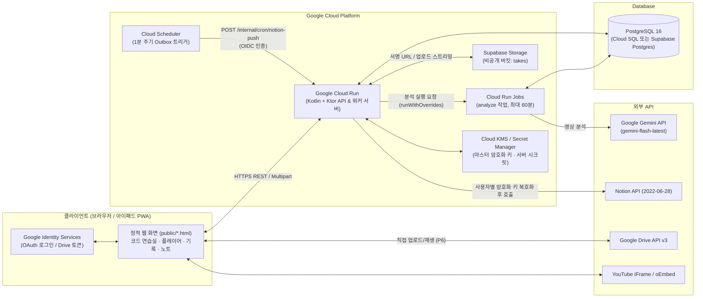

# 01. 프로젝트 기획서 (Kotlin + Google Cloud Run 전환)

> **문서 버전:** 2026-10-30 (시나리오 B: 다중 사용자 서비스 백엔드 구축)
> **대상 시스템:** ULeveLP (기타 코드 연습실 · 유튜브 구간 연습 플레이어 · AI 학습 영상 노트)

---

## 1. 배경 및 추진 목적

### 1.1 현재 구조(As-Is)의 한계
현재 ULeveLP는 만든 사람 1인을 위해 4개의 서로 다른 런타임과 무료 호스팅을 조합해 동작하고 있습니다.

1. **코드 연습실 (`public/chords.html`, `lib/*.js`):** GitHub Pages 정적 호스팅 및 로컬 Node.js(`server.js`)에서 동작.
2. **연습 플레이어 (`public/practice.html`):** 유튜브 구간 반복 및 녹음 데이터를 노션에 저장하기 위해 **Google Apps Script(`apps-script/Code.gs`)**를 중계 서버로 사용.
3. **AI 학습 영상 노트 (`public/notes.html`):** 브라우저에서 GitHub PAT로 **GitHub Actions(`analyze.yml`, `scripts/analyze.py`)**를 트리거하여 Gemini 영상 분석 및 노션 페이지를 생성.

이 구조를 다른 사용자에게 개방하려면 사용자마다 노션 통합 생성, DB 3개 구축, Apps Script 배포, 저장소 Fork 및 GitHub 토큰 발급을 직접 수행해야 하므로 일반 사용자의 진입 장벽이 지나치게 높습니다.

### 1.2 기존 BaaS(Supabase Edge Functions) 설계 대비 Kotlin + Cloud Run 전환 이유
초기 검토안에서는 서버를 직접 운영하지 않기 위해 **Supabase (PostgREST + PL/pgSQL RPC + Deno Edge Functions + Vault + `pg_cron`)** 중심의 설계를 검토했으나, 다음과 같은 기술적 리스크가 존재했습니다.

| 한계 영역 | 기존 Supabase BaaS 중심 설계의 문제점 | Kotlin + Google Cloud Run 전환 시 해결 방안 |
| --- | --- | --- |
| **장시간 AI 영상 분석 타임아웃** | Supabase Edge Function은 실행 시간 한도(150~400초)가 짧아 15~40분 분량의 유튜브 영상을 Gemini로 분석할 때 타임아웃 위험이 큼(영상을 쪼개 `pg_cron`으로 이어 붙이는 복잡한 우회 설계 필요) | **Cloud Run은 요청 타임아웃을 최대 60분(3,600초)까지 설정 가능**하며, Kotlin Coroutines 백그라운드 작업(또는 Cloud Run Jobs)을 통해 긴 영상도 분할 없이 한 번에 분석 가능 |
| **비즈니스 로직 및 언어 파편화** | 브라우저(JS) + Edge Functions(Deno TS) + DB 프로시저(PL/pgSQL 수백 줄) + 기존 분석 스크립트(Python)로 도메인 로직이 흩어짐 | 모든 서버 비즈니스 로직, 노션/Gemini 연동, 지판·건반 SVG 생성기를 **단일 Kotlin 코드베이스**로 일원화 |
| **테스트 및 디버깅 난이도** | PL/pgSQL 저장 프로시저(`add_practice`, `apply_notion_pull` 등)와 트리거에 핵심 로직이 박혀 있어 단위 테스트와 디버깅이 까다로움 | DB는 순수 영속성과 제약 조건에 집중하고, 도메인 규칙을 Kotlin 서비스 계층으로 올려 **JUnit 5 / Kotest**로 고속 단위·통합 테스트 수행 |
| **휴면(Pause) 및 인프라 제어** | Supabase 무료 플랜은 7일간 요청이 없으면 프로젝트가 일시정지되며, GitHub Pages만으로는 HTTP 보안 응답 헤더(`frame-ancestors`, HSTS 등) 제어 불가 | Cloud Run은 Scale-to-Zero(`min-instances=0`)로 유휴 비용이 없으면서도 **장기 미사용 일시정지가 없으며**, 정식 HTTP 보안 헤더와 멀티파트 스트리밍을 완벽 지원 |

---

## 2. 프로젝트 목표

- **G1. 가입 즉시 사용 (Zero-Config 온보딩):** Google 계정으로 로그인하면 노션·GitHub 설정 없이 연습 플레이어, 일별 연습 기록, 오디오 녹음을 즉시 사용할 수 있다.
- **G2. 인앱 기록 열람 및 성장 비교:** 노션에 의존하던 기록 열람(최근 12주 연습 달력, 곡 목록·상태 관리, 곡별 타임라인, 두 녹음 A/B 비교 듣기)을 웹 앱 내 전용 화면(`log.html`, `note.html`)으로 제공한다.
- **G3. 공식 노션 템플릿 호환 (Export / Import):** 기존 노션 DB 구조를 공식 템플릿으로 공개하고, 언제든 내 데이터를 노션 호환 ZIP(CSV + 녹음 파일)으로 내보내거나 노션 백업 ZIP을 서비스로 가져올 수 있다.
- **G4. BYOK (Bring Your Own Key) 실시간 노션 연동 & AI 학습 노트:**
  - 자신의 **노션 통합 키**를 등록한 사용자는 앱에서의 연습·녹음·노트가 노션 DB와 실시간 양방향(서비스 원본 + 노션 일부 항목 Pull)으로 동기화된다.
  - 자신의 **Gemini API 키**를 등록한 사용자는 유튜브 영상 분석 학습 노트를 생성할 수 있다(분석 비용은 각자의 API 키로 과금).
- **G5. 녹음 용량 부담 분산:** 기본 녹음 저장소(200MB 무료 한도)를 제공하되, 사용자가 원하면 본인의 **Google Drive(`drive.file` 권한)**를 연결해 용량 제한 없이 녹음을 저장할 수 있다.
- **G6. 고성능 단일 컨테이너 백엔드:** Kotlin(Ktor) 기반의 경량 컨테이너를 Google Cloud Run에 배포하여 운영 복잡도와 비용을 최소화한다.

---

## 3. 시스템 아키텍처 (To-Be)

### 3.1 기술 스택 선정
| 영역 | 기술 스택 | 선정 이유 |
| --- | --- | --- |
| **언어 / 런타임** | **Kotlin 2.0+ / JDK 21 (Eclipse Temurin Alpine)** | 정적 타입 안정성, Coroutines 기반 비동기 I/O, JRE 경량 이미지로 빠른 기동 |
| **웹 프레임워크** | **Ktor 3.x (Server & Client)** | Spring Boot 대비 메모리 점유율과 Cold Start가 월등히 적어 Cloud Run Scale-to-Zero에 최적 |
| **직렬화 / JSON** | **kotlinx.serialization** | 리플렉션 없는 고속 JSON 파싱, Gemini 동적 JSON 스키마 및 노션 블록 트리 모델링에 적합 |
| **DB 접근 / 마이그레이션** | **JetBrains Exposed (DAO/DSL) + HikariCP + Flyway** | Kotlin 네이티브 SQL DSL로 타입 안전한 쿼리 작성, `supabase/migrations` 대신 표준 Flyway(`V1__init.sql`)로 스키마 버전 관리 |
| **데이터베이스** | **PostgreSQL 16** (Supabase Postgres 또는 Cloud SQL) | JSONB(`analysis`, `config`), 배열(`tags`), `ON CONFLICT` Upsert, `FOR UPDATE SKIP LOCKED` 완벽 지원 |
| **파일 스토리지** | **Supabase Storage** (비공개 버킷 `takes`) | 서버가 서비스 키로 업로드(경로 `{userId}/{takeId}.{ext}`·쿼터는 서버가 강제)하고 60분 유효 서명 URL을 발급해 서버 대역폭 소모 없이 오디오 재생 |
| **키 암호화 보관** | **AES-256-GCM (Envelope Encryption) + GCP Secret Manager** | DB 종속적인 `vault.secrets` 대신 표준 AES-256-GCM으로 애플리케이션에서 암·복호화하여 `integrations` 테이블에 보관 |
| **프런트엔드** | **Vanilla JS (ES6+) + CSS 토큰** | 기존 코드베이스(`public/`) 100% 재사용, 빌드 과정 없는 단순성 유지 |

---

## 4. 사용자 역할 및 권한 체계

기능의 개방 여부는 사용자의 `role`이 아니라 **본인의 외부 API 키(Notion, Gemini) 등록 여부**로 결정됩니다.

| 역할 / 상태 | 대상 | 사용 가능 기능 |
| --- | --- | --- |
| **비로그인 (`guest`)** | 처음 방문한 사용자 | • 코드 연습실(`chords.html`) 전체 기능 • 연습 플레이어(`practice.html`) 구간 반복 (기록은 브라우저 `localStorage` `ulp:v:*`에만 저장) |
| **로그인 사용자 (`user`)** | Google 계정으로 로그인한 모든 사용자 | • 비로그인 기능 전체 + 첫 로그인 시 기기 로컬 기록 계정 이관 • 곡·일별 연습 기록·녹음 서버 저장 (기본 녹음 용량 200MB) • 인앱 기록 화면(`log.html`), 곡 상세 타임라인, A/B 녹음 비교 듣기 • 노션 공식 템플릿 ZIP 내보내기 및 노션 백업 ZIP 가져오기 • 본인 Google Drive 녹음 저장소 연결 |
| **노션 키 등록 사용자** | `SETTING`에 본인 노션 토큰·DB ID를 등록한 사용자 | • 로그인 사용자 기능 전체 • **노션 실시간 양방향 동기화** (서비스 변경사항 자동 Push + 노션 변경사항 Pull) |
| **Gemini 키 등록 사용자** | `SETTING`에 본인 Gemini API 키를 등록한 사용자 | • 로그인 사용자 기능 전체 • **AI 학습 영상 노트 생성** (`notes.html`) 및 인앱 열람(`note.html`), 노션 자동 발행 |
| **소유자 (`owner`)** | 서비스 운영자 (`profiles.role = 'owner'`) | • 기능 권한은 일반 사용자와 동일 • DB에서 직접 지정한 운영 수치(예: 기본 녹음 한도 `take_quota_bytes` 2GB 상향 등)만 차등 적용 |

---

## 5. 아키텍처 핵심 의사결정 (ADR)

| ID | 의사결정 사항 | 결정 내용 및 근거 |
| --- | --- | --- |
| **KC-D1** | **백엔드 단일화 (Kotlin + Cloud Run)** | 기존 `Code.gs`(Apps Script), `analyze.py`(GitHub Actions), Edge Functions, PL/pgSQL 프로시저를 단일 Ktor 애플리케이션으로 통합하여 배포·모니터링·테스트 창구를 하나로 합친다. |
| **KC-D2** | **프런트엔드 음악 계산 엔진 유지** | `public/lib/voicing.js`, `theory.js`는 브라우저에서 0ms 지연으로 동작해야 하므로 현행 JS 엔진을 유지한다. 단, 로컬/외부 연동용 `/api/*` 계산 엔드포인트는 Ktor 서버에서도 동일 스펙으로 제공한다. |
| **KC-D3** | **정적 파일 서빙 및 Origin 통합 옵션** | 프런트엔드는 기존처럼 GitHub Pages로 배포하거나 Cloud Run이 정적 파일까지 함께 서빙할 수 있다. Cloud Run 단일 서빙(또는 커스텀 도메인 연결) 시 Same-Origin이 되어 CORS preflight가 사라지고 HTTP CSP 헤더(`frame-ancestors 'none'`)를 완벽히 적용할 수 있다. GitHub Pages 유지 시에도 `ALLOWED_ORIGINS` 화이트리스트로 연동한다. |
| **KC-D4** | **SQL 프로시저 로직의 애플리케이션 계층 이관** | 기존 설계의 `add_practice`, `save_song_progress`, `apply_notion_pull`, `put_key` 등 PL/pgSQL 함수들을 Kotlin `PracticeService`, `NotionSyncService`, `IntegrationService`의 트랜잭션 메서드로 구현한다. DB는 표준 테이블·외래키·유니크 인덱스에 집중한다. |
| **KC-D5** | **외부 API 키 보안 (Envelope Encryption)** | 사용자가 등록한 노션 토큰과 Gemini 키는 Ktor 서버에서 마스터 키(Secret Manager 주입) 기반 **AES-256-GCM**(고유 12바이트 IV + 인증 태그)으로 암호화해 DB `integrations` 테이블에 저장한다. 클라이언트 응답에는 절대 원문을 포함하지 않고 끝 4자리(`hint`)만 반환한다. |
| **KC-D6** | **Gemini 영상 분석의 비동기 실행 (Cloud Run Jobs)** | 분석 요청 시 DB `analysis_jobs`에 `queued` 상태로 기록하고 즉시 `202 Accepted` (`{ jobId }`)를 반환한 뒤, 같은 컨테이너 이미지의 **Cloud Run Job `analyze`**를 `runWithOverrides`(인자 `jobId`)로 실행한다(작업 제한 시간 60분). 서비스 인스턴스 안의 Coroutine 워커는 쓰지 않는다 — Cloud Run 서비스는 응답 후 CPU를 줄이고 유휴 인스턴스를 종료하므로 작업이 `running`에 멈춘다. 1분 cron이 `started_at`이 70분 지난 `running` 작업을 `failed`(`error = 'timeout'`)로 정리한다. |
| **KC-D7** | **노션 실시간 동기화 (Outbox 패턴 + lease)** | 곡·세션·녹음·노트 변경 시 같은 DB 트랜잭션 안에서 `sync_outbox` 테이블에 이벤트를 적재한다. Cloud Scheduler의 1분 주기 호출(`POST /internal/cron/notion-push`)이 보장 경로이고, 저장 직후 즉시 트리거(Fast-path)는 응답 후 CPU 제한으로 끝까지 못 갈 수 있는 보조 경로다. 사용자별 동시 실행은 `notion_sync.lease_until`(짧은 트랜잭션으로 획득) 으로 막고, 노션 HTTP 호출은 DB 트랜잭션 밖에서 한다. |
| **KC-D8** | **다중 앱 키 공유 호환 (`app_id`)** | 동일 사용자의 `guitar-practice` 앱과 키 테이블을 공유할 수 있도록 `integrations` 테이블의 복합 PK를 `(user_id, app_id, provider)`로 유지한다. |
| **KC-D9** | **BYOK & 로컬 저장소 보안 (X1 적용 완료)** | 노션 실시간 연동과 Gemini 학습 노트는 각 키를 등록한 사용자 전용이다(`ulp:keys`에 끝 4자리·갱신 시각만 캐시). 모든 새 localStorage 키는 `ulp:` 접두어를 쓰고, XSS 정적 검사(`test/security.test.js`)와 CSP meta를 모든 HTML에 적용한다. |

---

## 6. 단계별 구축 일정 및 작업 소요 (총 2.5 ~ 4주)

1인 풀타임 개발 기준 산정치이며, 각 단계는 이전 단계의 인수 테스트를 통과한 후 진행합니다.

| 단계 | 주요 작업 내용 | 관련 요구사항 | 예상 소요 | 완료 기준 (Milestone) |
| --- | --- | --- | --- | --- |
| **P0. 기반 구축 · 인증 · DB** | • Ktor 프로젝트,マルチ스테이지 Dockerfile, Cloud Run CI/CD 구성 • Flyway `V1__init.sql` 작성 및 PostgreSQL 연동 • Google OAuth2 로그인 및 JWT 발급/검증 미들웨어 • 권한 격리 및 보안 헤더(CSP) 통합 테스트 | `FR-AUTH` `NFR-SEC` | **3 ~ 4일** | 구글 로그인/로그아웃, JWT 인증, 타 사용자 데이터 접근 차단 테스트 통과 |
| **P1. 플레이어 저장 · 녹음** | • 곡(`songs`), 연습 기록(`sessions`), 녹음(`takes`) API 구현 • 1분 미만 연습 시간 보류(`keep`) 및 원자적 시간 합산 로직 • Supabase Storage 업로드·서명 URL 발급·200MB 쿼터 제한 • 비로그인 로컬 기록(`ulp:v:*`, `pp:v:*`) 계정 마이그레이션 API | `FR-SONG` `FR-SESSION` `FR-TAKE` `FR-LOCAL` | **3 ~ 4일** | 노션 설정 없이 구글 로그인만으로 플레이어 자동 저장 및 녹음 업로드/재생 동작 |
| **P2. 인앱 기록 · 보관함 화면** | • 12주 연습 시간 달력 집계 및 주간/월간 통계 API • 곡 상세 타임라인 및 두 녹음 A/B 비교 재생 UI(`log.html`) • 첫 화면(`index.html`) 및 플레이어 곡 목록 서랍을 신규 API로 연결 | `FR-LOG` `FR-LIB` | **2.5 ~ 3일** | 노션을 열지 않고도 앱 내에서 연습 달력, 곡별 기록, 녹음 비교 청취 가능 |
| **P3. 노션 템플릿 · ZIP 입출력** | • 공식 노션 템플릿 페이지 공개 및 안내 연결 • 서비스 → 노션 호환 ZIP(UTF-8 BOM CSV + 오디오 파일) 내보내기 • 노션 Markdown & CSV ZIP 업로드 → 미리보기(Dry-run) → 확정 Upsert API | `FR-NX` | **2.5 ~ 3일** | 노션 템플릿 복제 후 CSV 병합 성공, 노션 백업 ZIP 가져오기 왕복 테스트 통과 |
| **P4. 키 보관 · 노션 실시간 연동** | • AES-256-GCM 키 암호화 저장, 연결 상태 확인(`check`), 해제 API • `sync_outbox` 기반 `NotionPushWorker` (오디오 20MB+ 분할 업로드 포함) • 증분 `NotionPullService` (5분 쿨다운) 및 초기 전체 연동(`full` 모드) • 기존 `apps-script/` 폐기 | `FR-KEY` `FR-SYNC` | **4 ~ 5일** | 노션 키 등록 후 플레이어에서 연습/녹음 시 1분 내 노션 반영, 노션 수정사항 Pull 확인 |
| **P5. Gemini 학습 노트 이관** | • `scripts/schemas.py`, `analyze.py`를 Kotlin `GeminiAnalyzeService`로 이관 • `guitar.py`, `keyboard.py` SVG 생성기를 Kotlin으로 이관 • 비동기 분석 잡 실행, 상태 폴링, 인앱 노트 뷰어(`note.html`) 구현 • 기존 `.github/workflows/analyze.yml` 및 Python 스크립트 폐기 | `FR-NOTE` | **3 ~ 4일** | Gemini 키 등록 사용자가 영상 분석 요청 시 앱 내 노트 생성 및 노션 자동 발행 완료 |
| **P6. Google Drive 저장소** | • Google Identity Services(`drive.file`) 기반 클라이언트 업로드(`drive.js`) • 기존 스토리지 녹음을 Google Drive로 이전하고 스토리지 용량 회수 | `FR-DRIVE` | **2 ~ 3일** | 드라이브 연결 사용자의 신규/기존 녹음이 본인 구글 드라이브에서 저장·재생됨 |

---

## 7. 주요 리스크 및 대응 전략

| 리스크 항목 | 영향도 | 대응 전략 |
| --- | --- | --- |
| **Cloud Run Cold Start 지연** | 중 | • 무거운 프레임워크 대신 **Ktor + `kotlinx.serialization`**(리플렉션 최소화) 채택 • Docker 이미지를 `eclipse-temurin:21-jre-alpine` 기반으로 경량화하고 Cloud Run **Startup CPU Boost** 활성화 (Cold Start 1.5초 이내 달성) |
| **비동기 Gemini 분석 중 컨테이너 CPU 스로틀링** | 상 | • 분석은 서비스 인스턴스가 아니라 **Cloud Run Jobs**에서 실행(KC-D6). Cloud Tasks HTTP 대상은 처리 기한이 최대 30분이라 긴 영상에 부족해 쓰지 않는다 • 멈춘 `running` 작업은 1분 cron이 70분 기준으로 `failed` 정리 |
| **노션 API Rate Limit (429 Too Many Requests)** | 중 | • `NotionClient`에 지수 백오프(Exponential Backoff) 및 `Retry-After` 헤더 준수 로직 내장 • `sync_outbox` 처리 시 사용자별 lease(`notion_sync.lease_until`)로 직렬화하고 최대 5회 재시도 후 실패 상태 표시 |
| **Supabase 무료 플랜 일시정지** | 중 | • 무료 프로젝트는 7일간 활동이 없으면 일시정지된다. DB도 Supabase면 1분 cron의 DB 접근이 활동이 되고, DB가 Cloud SQL이면 cron이 하루 1회 Storage 목록 조회로 활동을 남긴다. 사용자가 늘면 Pro 플랜으로 전환 |
| **타 사용자 데이터 접근 및 키 유출 보안 사고** | 상 | • 모든 Repository 쿼리에 `userId` 조건을 강제하는 Kotlin 타입 래퍼(`AuthenticatedUser`) 적용 • API 키 원문은 AES-256-GCM으로 암호화하며, 복호화 메서드는 `NotionSyncService`와 `GeminiAnalyzeService` 내부에서만 호출 가능하도록 모듈 가시성(`internal`) 제한 |
| **노션 실시간 연동과 Google Drive 저장 충돌** | 중 | • 백엔드 워커는 사용자의 개인 Google Drive 파일을 백그라운드에서 읽을 수 없으므로, **노션 실시간 연동(`notion_sync.enabled = true`)이 켜진 사용자는 기본 스토리지(Supabase Storage)를 사용**하도록 강제하고 UI에서 상호 배타적으로 안내 |

