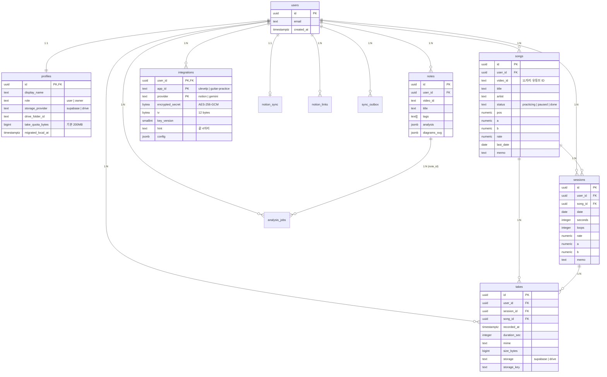

# 04. 데이터베이스 설계서 (PostgreSQL 16 + Flyway)

> **문서 버전:** 2026-10-30
> **대상 DBMS:** PostgreSQL 16 (Google Cloud SQL 또는 Supabase Postgres 호환)
> **마이그레이션 도구:** Flyway (`src/main/resources/db/migration/V1__init.sql`)

---

## 1. 설계 원칙 및 ERD

1. **표준 PostgreSQL 지향 (Vendor Lock-in 제거):** 기존 설계의 Supabase 전용 확장(`vault.secrets`, `auth.uid()` RLS 강제, `private` 스키마 RPC 해킹) 의존성을 제거하고, 표준 PostgreSQL 16 DDL로 설계했습니다. (단, DB 인프라로 Supabase Postgres를 그대로 사용할 경우에도 완벽히 동작합니다.)
2. **비즈니스 로직의 Kotlin 애플리케이션 계층 이동:** 복잡한 분기(1분 미만 세션 생성 보류, 노션 Pull 루프 방지, 키 형식 정규식 검증 등)는 PL/pgSQL 함수 대신 Kotlin 서비스 트랜잭션으로 제어하며, DB는 **외래키(Cascade), Check 제약조건, Unique 제약조건을 통한 데이터 무결성**을 보장합니다.
3. **Envelope Encryption 기반 키 보관:** `integrations` 테이블은 애플리케이션에서 **AES-256-GCM**으로 암호화된 바이트(`encrypted_secret`)와 초기화 벡터(`iv`)만 저장합니다.



---

## 2. 표준 DDL (`V1__init.sql`)

```sql
CREATE EXTENSION IF NOT EXISTS pgcrypto;

-- updated_at 자동 갱신 공통 트리거 함수
CREATE OR REPLACE FUNCTION set_updated_at() RETURNS TRIGGER LANGUAGE plpgsql AS $$
BEGIN
  NEW.updated_at = now();
  RETURN NEW;
END $$;

-- ============================================================
-- 1. users & profiles (사용자 계정 및 프로필)
-- ============================================================
CREATE TABLE users (
  id           UUID PRIMARY KEY,      -- Supabase Auth 사용자 id (JWT sub). 서버가 만들지 않는다
  email        TEXT NOT NULL,         -- 구글 계정 이메일은 바뀔 수 있어 UNIQUE를 걸지 않는다. 신원은 id
  created_at   TIMESTAMPTZ NOT NULL DEFAULT now()
);

CREATE TABLE profiles (
  id                 UUID PRIMARY KEY REFERENCES users(id) ON DELETE CASCADE,
  display_name       TEXT NOT NULL DEFAULT '',
  role               TEXT NOT NULL DEFAULT 'user' CHECK (role IN ('user', 'owner')),
  storage_provider   TEXT NOT NULL DEFAULT 'supabase' CHECK (storage_provider IN ('supabase', 'drive')),
  drive_folder_id    TEXT,
  take_quota_bytes   BIGINT NOT NULL DEFAULT 209715200 CHECK (take_quota_bytes >= 0), -- 기본 200MB
  migrated_local_at  TIMESTAMPTZ,
  created_at         TIMESTAMPTZ NOT NULL DEFAULT now(),
  updated_at         TIMESTAMPTZ NOT NULL DEFAULT now()
);
CREATE TRIGGER profiles_updated BEFORE UPDATE ON profiles FOR EACH ROW EXECUTE FUNCTION set_updated_at();

-- ============================================================
-- 2. songs (연습 곡 - 노션: 연습 곡 DB)
-- ============================================================
CREATE TABLE songs (
  id          UUID PRIMARY KEY DEFAULT gen_random_uuid(),
  user_id     UUID NOT NULL REFERENCES users(id) ON DELETE CASCADE,
  title       TEXT NOT NULL,
  artist      TEXT NOT NULL DEFAULT '',
  status      TEXT NOT NULL DEFAULT 'practicing' CHECK (status IN ('practicing', 'paused', 'done')),
  video_id    TEXT NOT NULL CHECK (video_id ~ '^[A-Za-z0-9_-]{11}$'),
  pos         NUMERIC(8,1),
  a           NUMERIC(8,1),
  b           NUMERIC(8,1),
  rate        NUMERIC(4,2) NOT NULL DEFAULT 1.00,
  last_date   DATE,
  memo        TEXT NOT NULL DEFAULT '',
  created_at  TIMESTAMPTZ NOT NULL DEFAULT now(),
  updated_at  TIMESTAMPTZ NOT NULL DEFAULT now(),
  UNIQUE (user_id, video_id),
  UNIQUE (user_id, id),            -- 하위 테이블 복합 FK 대상 (다른 사용자 곡 참조 차단)
  CHECK (a IS NULL OR b IS NULL OR a < b)
);
CREATE INDEX songs_user_status_idx ON songs (user_id, status, last_date DESC NULLS LAST, updated_at DESC);
CREATE TRIGGER songs_updated BEFORE UPDATE ON songs FOR EACH ROW EXECUTE FUNCTION set_updated_at();

-- ============================================================
-- 3. sessions (일별 연습 기록 - 노션: 연습 기록 DB)
-- ============================================================
CREATE TABLE sessions (
  id          UUID PRIMARY KEY DEFAULT gen_random_uuid(),
  user_id     UUID NOT NULL REFERENCES users(id) ON DELETE CASCADE,
  song_id     UUID NOT NULL,
  date        DATE NOT NULL,
  seconds     INTEGER NOT NULL DEFAULT 0 CHECK (seconds >= 0),
  loops       INTEGER NOT NULL DEFAULT 0 CHECK (loops >= 0),
  rate        NUMERIC(4,2),
  a           NUMERIC(8,1),
  b           NUMERIC(8,1),
  memo        TEXT NOT NULL DEFAULT '',
  created_at  TIMESTAMPTZ NOT NULL DEFAULT now(),
  updated_at  TIMESTAMPTZ NOT NULL DEFAULT now(),
  UNIQUE (user_id, song_id, date),
  UNIQUE (user_id, id, song_id),   -- takes 복합 FK 대상
  FOREIGN KEY (user_id, song_id) REFERENCES songs (user_id, id) ON DELETE CASCADE
);
CREATE INDEX sessions_user_date_idx ON sessions (user_id, date DESC);
CREATE INDEX sessions_song_date_idx ON sessions (song_id, date DESC);
CREATE TRIGGER sessions_updated BEFORE UPDATE ON sessions FOR EACH ROW EXECUTE FUNCTION set_updated_at();

-- ============================================================
-- 4. takes (오디오 녹음 - 노션: 연습 기록 본문 오디오 블록 + 녹음 속성)
-- ============================================================
CREATE TABLE takes (
  id            UUID PRIMARY KEY DEFAULT gen_random_uuid(),
  user_id       UUID NOT NULL REFERENCES users(id) ON DELETE CASCADE,
  session_id    UUID NOT NULL,
  song_id       UUID NOT NULL,
  recorded_at   TIMESTAMPTZ NOT NULL,
  a             NUMERIC(8,1),
  b             NUMERIC(8,1),
  rate          NUMERIC(4,2),
  duration_sec  INTEGER NOT NULL CHECK (duration_sec >= 0),
  mime          TEXT NOT NULL CHECK (mime IN ('audio/mp4', 'audio/webm', 'audio/ogg', 'audio/mpeg', 'audio/wav', 'audio/aac')),
  size_bytes    BIGINT NOT NULL CHECK (size_bytes > 0 AND size_bytes <= 52428800), -- 최대 50MB
  storage       TEXT NOT NULL CHECK (storage IN ('supabase', 'drive')),
  storage_key   TEXT NOT NULL,
  memo          TEXT NOT NULL DEFAULT '',
  created_at    TIMESTAMPTZ NOT NULL DEFAULT now(),
  -- 녹음의 사용자·세션·곡이 서로 같은 사용자, 같은 곡을 가리키도록 강제
  FOREIGN KEY (user_id, session_id, song_id) REFERENCES sessions (user_id, id, song_id) ON DELETE CASCADE
);
CREATE INDEX takes_session_idx ON takes (session_id, recorded_at);
CREATE INDEX takes_song_idx ON takes (song_id, recorded_at DESC);
CREATE INDEX takes_user_storage_idx ON takes (user_id, storage);

-- ============================================================
-- 5. notes & analysis_jobs (Gemini 학습 영상 노트)
-- ============================================================
CREATE TABLE notes (
  id            UUID PRIMARY KEY DEFAULT gen_random_uuid(),
  user_id       UUID NOT NULL REFERENCES users(id) ON DELETE CASCADE,
  video_id      TEXT NOT NULL CHECK (video_id ~ '^[A-Za-z0-9_-]{11}$'),
  title         TEXT NOT NULL,
  channel       TEXT NOT NULL DEFAULT '',
  tags          TEXT[] NOT NULL,
  memo          TEXT NOT NULL DEFAULT '',
  headline      TEXT NOT NULL DEFAULT '',
  points        TEXT[] NOT NULL DEFAULT '{}',
  keywords      TEXT[] NOT NULL DEFAULT '{}',
  difficulty    TEXT CHECK (difficulty IN ('입문', '중급', '고급')),
  analysis      JSONB NOT NULL,                 -- Gemini 스키마 응답 원본
  diagrams_svg  JSONB NOT NULL DEFAULT '[]',    -- 화성 진행별 렌더링된 SVG 문자열 배열
  model         TEXT NOT NULL DEFAULT '',
  created_at    TIMESTAMPTZ NOT NULL DEFAULT now(),
  updated_at    TIMESTAMPTZ NOT NULL DEFAULT now()
);
CREATE INDEX notes_user_created_idx ON notes (user_id, created_at DESC);
CREATE TRIGGER notes_updated BEFORE UPDATE ON notes FOR EACH ROW EXECUTE FUNCTION set_updated_at();

CREATE TABLE analysis_jobs (
  id           UUID PRIMARY KEY DEFAULT gen_random_uuid(),
  user_id      UUID NOT NULL REFERENCES users(id) ON DELETE CASCADE,
  url          TEXT NOT NULL,
  tags         TEXT[] NOT NULL CHECK (cardinality(tags) > 0),
  memo         TEXT NOT NULL DEFAULT '',
  status       TEXT NOT NULL DEFAULT 'queued' CHECK (status IN ('queued', 'running', 'done', 'failed')),
  error        TEXT,
  note_id      UUID REFERENCES notes(id) ON DELETE SET NULL,
  created_at   TIMESTAMPTZ NOT NULL DEFAULT now(),
  started_at   TIMESTAMPTZ,
  finished_at  TIMESTAMPTZ
);
CREATE INDEX analysis_jobs_user_idx ON analysis_jobs (user_id, created_at DESC);

-- ============================================================
-- 6. integrations (외부 API 키 보관 - AES-256-GCM 암호화)
-- ============================================================
CREATE TABLE integrations (
  user_id           UUID NOT NULL REFERENCES users(id) ON DELETE CASCADE,
  app_id            TEXT NOT NULL CHECK (app_id IN ('ulevelp', 'guitar-practice')),
  provider          TEXT NOT NULL CHECK (provider IN ('notion', 'gemini')),
  encrypted_secret  BYTEA NOT NULL,             -- AES-256-GCM 암호문 + 16바이트 Auth Tag
  iv                BYTEA NOT NULL CHECK (octet_length(iv) = 12), -- 96-bit 고유 IV
  key_version       SMALLINT NOT NULL DEFAULT 1, -- 마스터 키 회전(Rotation) 대비 버전
  hint              TEXT NOT NULL,              -- 키 끝 4자리 (화면 표시용)
  config            JSONB NOT NULL DEFAULT '{}' CHECK (jsonb_typeof(config) = 'object'),
  created_at        TIMESTAMPTZ NOT NULL DEFAULT now(),
  updated_at        TIMESTAMPTZ NOT NULL DEFAULT now(),
  PRIMARY KEY (user_id, app_id, provider)
);
CREATE TRIGGER integrations_updated BEFORE UPDATE ON integrations FOR EACH ROW EXECUTE FUNCTION set_updated_at();

-- ============================================================
-- 7. notion_sync, notion_links, sync_outbox (노션 실시간 연동)
-- ============================================================
CREATE TABLE notion_sync (
  user_id       UUID PRIMARY KEY REFERENCES users(id) ON DELETE CASCADE,
  enabled       BOOLEAN NOT NULL DEFAULT false,
  last_push_at  TIMESTAMPTZ,
  last_pull_at  TIMESTAMPTZ,
  last_error    TEXT,
  lease_until   TIMESTAMPTZ,    -- Push 워커 점유 만료 시각 (3.4절). NULL 또는 과거면 비어 있음
  lease_owner   TEXT,           -- 점유한 워커 식별자 (인스턴스 ID + 난수)
  updated_at    TIMESTAMPTZ NOT NULL DEFAULT now()
);
CREATE TRIGGER notion_sync_updated BEFORE UPDATE ON notion_sync FOR EACH ROW EXECUTE FUNCTION set_updated_at();

CREATE TABLE notion_links (
  entity          TEXT NOT NULL CHECK (entity IN ('song', 'session', 'take', 'note')),
  entity_id       UUID NOT NULL,
  user_id         UUID NOT NULL REFERENCES users(id) ON DELETE CASCADE,
  notion_page_id  TEXT NOT NULL,  -- song·session·note: 노션 페이지 ID, take: 오디오 블록 ID
  notion_extra    TEXT,           -- take: 캡션 문단 블록 ID
  synced_at       TIMESTAMPTZ NOT NULL DEFAULT now(),
  PRIMARY KEY (entity, entity_id)
);
CREATE UNIQUE INDEX notion_links_user_page_idx ON notion_links (user_id, notion_page_id);

CREATE TABLE sync_outbox (
  id          BIGSERIAL PRIMARY KEY,
  user_id     UUID NOT NULL REFERENCES users(id) ON DELETE CASCADE,
  entity      TEXT NOT NULL CHECK (entity IN ('song', 'session', 'take', 'note')),
  entity_id   UUID NOT NULL,
  op          TEXT NOT NULL CHECK (op IN ('upsert', 'delete')),
  attempts    INTEGER NOT NULL DEFAULT 0,
  last_error  TEXT,
  created_at  TIMESTAMPTZ NOT NULL DEFAULT now(),
  done_at     TIMESTAMPTZ
);
CREATE INDEX sync_outbox_pending_idx ON sync_outbox (user_id, id) WHERE done_at IS NULL;

-- ============================================================
-- 8. storage_trash (지울 스토리지 파일 대기열)
-- ============================================================
-- 곡·녹음·계정 삭제 시 DB 행과 같은 트랜잭션에서 파일 키를 넣고, 커밋 후 즉시 + 1분 cron이 실제 파일을 지운다.
-- 사용자 행이 지워져도 남아야 하므로 users FK를 걸지 않는다.
CREATE TABLE storage_trash (
  id           BIGSERIAL PRIMARY KEY,
  storage_key  TEXT NOT NULL,       -- Supabase Storage 'takes' 버킷 경로
  attempts     INTEGER NOT NULL DEFAULT 0,
  last_error   TEXT,
  created_at   TIMESTAMPTZ NOT NULL DEFAULT now()
);
```

---

## 3. 핵심 트랜잭션 및 동시성 처리 패턴 (Kotlin + SQL)

### 3.1 연습 시간 누적 합산 및 1분 미만 보류 (`PracticeService.saveProgress`)
다중 기기 동시 요청 시에도 `sessions` 행이 중복 생성되거나 시간이 유실되지 않도록 단일 트랜잭션 내에서 처리합니다.
**구현(A0 결정):** raw SQL 대신 같은 의미의 Exposed DSL로 씁니다 — ① `songs` 행을 `SELECT … FOR UPDATE`로 잠가 소유 확인(0행이면 `404 NOT_FOUND`) ② `last_date = max(기존, date)`를 Kotlin에서 계산해 UPDATE ③ 아래 2번 UPDATE ④ 0행이고 60초 이상이면 `INSERT … ON CONFLICT DO NOTHING`(`insertIgnore`), 충돌이면 2번 UPDATE를 한 번 더. ①의 행 잠금으로 같은 곡 저장은 차례로 처리되고, ④는 잠금이 없는 경로(다른 곡 행 등)에 대한 안전장치입니다. 단계별 상세는 `개발산출물/명세/K1-1_구현명세.md` 5.7절. 아래 SQL은 의미 설명용입니다.

```sql
-- 1. 곡 위치·구간·속도 갱신 (소유 확인 겸용)
UPDATE songs
   SET pos = :pos, a = :a, b = :b, rate = COALESCE(:rate, rate),
       last_date = GREATEST(COALESCE(last_date, :date), :date)
 WHERE id = :songId AND user_id = :userId
 RETURNING id;
-- 0행이면 남의 곡이거나 없는 곡: 롤백하고 404 NOT_FOUND. 아래 2·3번으로 가지 않는다

-- 2. 이미 당일 세션이 존재하는지 먼저 UPDATE 시도
UPDATE sessions
   SET seconds = seconds + :addSeconds,
       loops   = loops + :addLoops,
       rate    = COALESCE(:rate, rate),
       a       = :a,
       b       = :b
 WHERE user_id = :userId AND song_id = :songId AND date = :date
 RETURNING id, seconds;

-- 3. (2번 결과가 0행일 때)
--    addSeconds < 60 이면 INSERT 하지 않고 { keep = true } 반환.
--    addSeconds >= 60 이면 동시성 충돌 방지를 위해 ON CONFLICT DO UPDATE 실행:
INSERT INTO sessions (user_id, song_id, date, seconds, loops, rate, a, b)
VALUES (:userId, :songId, :date, :addSeconds, :addLoops, :rate, :a, :b)
ON CONFLICT (user_id, song_id, date) DO UPDATE
   SET seconds = sessions.seconds + EXCLUDED.seconds,
       loops   = sessions.loops + EXCLUDED.loops,
       rate    = COALESCE(EXCLUDED.rate, sessions.rate),
       a       = EXCLUDED.a,
       b       = EXCLUDED.b
RETURNING id, seconds;
```

### 3.2 녹음 쿼터(200MB) Race Condition 방지 (`TakeService.upload`)
동시에 여러 녹음을 업로드하여 쿼터를 우회하는 것을 막기 위해, 사용자 `profiles` 행에 `FOR UPDATE` 잠금을 걸고 사용량을 검사합니다.

```sql
-- 트랜잭션 시작
SELECT take_quota_bytes FROM profiles WHERE id = :userId FOR UPDATE;

SELECT COALESCE(SUM(size_bytes), 0) AS used_bytes
  FROM takes
 WHERE user_id = :userId AND storage = 'supabase';

-- 애플리케이션에서 used_bytes + newFileSize > take_quota_bytes 이면
-- TAKE_QUOTA_EXCEEDED (413) 예외 발생 및 롤백
```

**업로드 순서 (파일과 DB 행이 어긋나지 않게):**
1. 소유 확인(`songId`가 내 곡인지) + 잠금 없는 쿼터 사전 검사 → 초과면 업로드 전에 413.
2. 서버가 `takeId`를 먼저 만들고 Storage `{userId}/{takeId}.{ext}`에 업로드 (DB 트랜잭션 밖, 오래 걸려도 잠금 없음).
3. 짧은 트랜잭션: 곡 소유 재확인 → 위 `FOR UPDATE` 쿼터 재검사 → `ensureSession`(없으면 0초·0회 세션 생성, 있으면 그 세션 값은 바꾸지 않음) → `takes` INSERT → Outbox 적재(새 세션이면 `session` 먼저, 그다음 `take`) → 커밋.
4. 3번이 실패하면 방금 올린 파일을 지운다. 그 삭제마저 실패하면 `storage_trash`에 넣어 cron이 지운다.

### 3.2.1 삭제 시 스토리지 파일 정리 (`storage_trash`)
DB 행은 `ON DELETE CASCADE`로 지워지지만 Storage 파일은 DB 트랜잭션에 묶이지 않습니다. 그래서 삭제 트랜잭션 **안에서** 지울 파일 키를 `storage_trash`에 넣고, 커밋 뒤 즉시 삭제를 시도하며, 실패분은 1분 cron이 다시 지웁니다.
```sql
-- 곡 삭제 (DELETE /api/v1/songs/{id}) 트랜잭션
INSERT INTO storage_trash (storage_key)
SELECT storage_key FROM takes
 WHERE user_id = :userId AND song_id = :songId AND storage = 'supabase';
-- 노션 연동 중이면 곡과 그 세션 페이지 아카이브 이벤트 적재 (녹음 블록은 세션 페이지와 함께 아카이브됨)
--   enqueue(song, :songId, 'delete'), 각 세션에 enqueue(session, :sessionId, 'delete')
DELETE FROM songs WHERE id = :songId AND user_id = :userId;   -- sessions·takes CASCADE
```
- 녹음 1개 삭제·계정 삭제도 같은 방식으로 `storage_trash`를 거칩니다(계정 삭제는 `takes/{userId}/` 경로 전체).
- Push 워커는 `delete` 처리에 성공하면 해당 `notion_links` 행을 지웁니다(`notion_links`는 여러 테이블을 가리켜 FK가 없으므로 앱이 정리).

### 3.3 Outbox 적재 중복 제거 및 무한 루프 방지 (`NotionSyncOutboxHelper`)
DB 트리거에 숨겨진 전역 세션 변수(`current_setting('app.sync_source')`) 대신, **Kotlin 서비스 계층에서 명시적으로 Outbox 적재 함수를 호출**합니다.
- **사용자 액션(`SongService`, `PracticeService`, `TakeService`, `NoteService`):** 변경 트랜잭션 커밋 직전에 `outboxRepository.enqueueIfSyncEnabled(userId, entity, entityId, op)`를 호출합니다.
- **노션에서 가져온 변경(`NotionPullService`):** `enqueueIfSyncEnabled`를 호출하지 않으므로 노션에서 가져온 데이터가 다시 노션으로 Push되는 무한 루프가 원천적으로 발생하지 않습니다.
- **대기열 중복 방지:** 구현은 `OutboxRepository.enqueueIfSyncEnabled`(Exposed DSL, 호출한 트랜잭션 안에서 실행). **중복 제거는 `op = 'upsert'`에만 적용**합니다 — 대기 중인 `upsert`가 있어도 `delete`는 항상 넣습니다(A0 수정: 예전 쿼리는 `delete`까지 건너뛰어 삭제가 노션에 반영되지 않을 수 있었음). 동시 요청으로 `upsert`가 드물게 2건 들어가도 워커가 멱등이므로 무해합니다.
```sql
INSERT INTO sync_outbox (user_id, entity, entity_id, op)
SELECT :userId, :entity, :entityId, :op
 WHERE EXISTS (SELECT 1 FROM notion_sync WHERE user_id = :userId AND enabled = true)
   AND NOT (:op = 'upsert' AND EXISTS (
     SELECT 1 FROM sync_outbox
      WHERE user_id = :userId AND entity = :entity AND entity_id = :entityId
        AND op = 'upsert' AND done_at IS NULL
   ));
```

### 3.4 Outbox 워커 동시 실행 제어 (`NotionPushWorker`)
클라이언트의 즉시 Push 호출과 Cloud Scheduler의 1분 주기 배치 호출이 겹치더라도 같은 사용자의 작업이 두 번 실행되지 않도록 `notion_sync`의 **lease(점유 만료 시각)**를 씁니다.
트랜잭션 Advisory Lock(`pg_try_advisory_xact_lock`)은 트랜잭션이 끝나면 풀리므로, 쓰려면 노션 HTTP 호출(최대 20MB+ 업로드)을 트랜잭션 안에서 해야 해 DB 연결을 오래 붙잡습니다. lease는 획득·해제만 짧은 트랜잭션으로 하고, 노션 호출은 트랜잭션 밖에서 합니다. 인스턴스가 중간에 죽어도 만료 시각이 지나면 다른 워커가 이어 받습니다.

```sql
-- 1. lease 획득 (0행이면 다른 워커가 처리 중 → 건너뜀)
UPDATE notion_sync
   SET lease_until = now() + interval '5 minutes', lease_owner = :worker
 WHERE user_id = :userId AND enabled = true
   AND (lease_until IS NULL OR lease_until < now())
RETURNING user_id;

-- 2. 대기열 한 건씩 (트랜잭션 밖에서 노션 호출 → 결과만 짧게 기록)
SELECT id, entity, entity_id, op FROM sync_outbox
 WHERE user_id = :userId AND done_at IS NULL AND attempts < 5
 ORDER BY id LIMIT 20;
UPDATE sync_outbox SET done_at = now() WHERE id = :id;                        -- 성공
UPDATE sync_outbox SET attempts = attempts + 1, last_error = :err WHERE id = :id;  -- 실패

-- 처리 중간마다 연장 (한 건 처리가 길어도 lease가 만료되지 않게)
UPDATE notion_sync SET lease_until = now() + interval '5 minutes'
 WHERE user_id = :userId AND lease_owner = :worker;

-- 3. 해제
UPDATE notion_sync SET lease_until = NULL, lease_owner = NULL, last_push_at = now()
 WHERE user_id = :userId AND lease_owner = :worker;
```

---

## 4. 노션 공식 템플릿 1:1 매핑 규격

기존 `Code.gs` 및 `analyze.py`가 생성하던 노션 데이터베이스 속성 이름·타입과 100% 동일하게 매핑합니다.

### 4.1 `연습 곡` DB ↔ `songs` 테이블
| 노션 속성명 | 노션 타입 | DB 컬럼 | 변환 규칙 |
| --- | --- | --- | --- |
| `곡명` | `title` | `title` | 빈 값이면 `"(제목 없음)"` |
| `아티스트` | `rich_text` | `artist` | |
| `상태` | `select` | `status` | `연습 중` ↔ `practicing`, `보류` ↔ `paused`, `완료` ↔ `done` |
| `유튜브 링크` | `url` | `video_id` | `https://www.youtube.com/watch?v={video_id}` |
| `이어서 연습` | `url` | *(동적 계산)* | `{siteUrl}/practice.html?v={video_id}&t={pos}&a={a}&b={b}&r={rate}` |
| `마지막 위치(초)` | `number` | `pos` | 소수 둘째 자리 반올림 |
| `구간 시작(초)` | `number` | `a` | |
| `구간 끝(초)` | `number` | `b` | |
| `속도` | `number` | `rate` | |
| `마지막 연습일` | `date` | `last_date` | `YYYY-MM-DD` |
| `메모` | `rich_text` | `memo` | |

### 4.2 `연습 기록` DB ↔ `sessions` + `takes` 테이블
| 노션 속성명 | 노션 타입 | DB 컬럼 | 변환 규칙 |
| --- | --- | --- | --- |
| `기록` | `title` | *(동적 계산)* | `{date} {곡명}` |
| `곡` | `relation` | `song_id` | `notion_links`의 곡 `notion_page_id` 참조 |
| `날짜` | `date` | `date` | `YYYY-MM-DD` |
| `연습 시간(분)` | `number` | `seconds` | Push: `round(seconds / 60.0, 2)` / Pull: `round(minutes * 60)` |
| `반복 횟수` | `number` | `loops` | |
| `속도` | `number` | `rate` | |
| `구간` | `rich_text` | `a`, `b` | `m:ss–m:ss` (en dash `–`) |
| `메모` | `rich_text` | `memo` | |
| `녹음` | `files` | `takes` | 본문 하단 캡션 문단(`🎙 HH:MM · 구간 · 속도 · 길이`) + `audio` 블록 추가 및 `녹음` 파일 속성에 첨부 |

### 4.3 `학습 영상 노트` DB ↔ `notes` 테이블
| 노션 속성명 | 노션 타입 | DB 컬럼 | 변환 규칙 |
| --- | --- | --- | --- |
| `제목` | `title` | `title` | |
| `URL` | `url` | `video_id` | `https://www.youtube.com/watch?v={video_id}` |
| `태그` | `multi_select` | `tags` | `화성`, `사운드 디자인`, `DAW/MIDI`, `리듬`, `편곡`, `믹싱`, `TAB` |
| `채널` | `rich_text` | `channel` | |
| `요약` | `rich_text` | `headline` | `analysis.summary.headline` |
| `키워드` | `multi_select` | `keywords` | 쉼표 제거, 최대 100자 |
| `난이도` | `select` | `difficulty` | `입문`, `중급`, `고급` |
| `메모` | `rich_text` | `memo` | |

